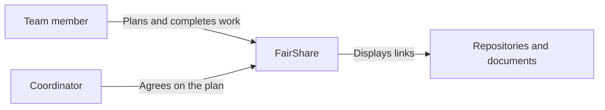
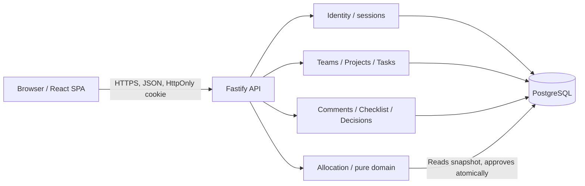
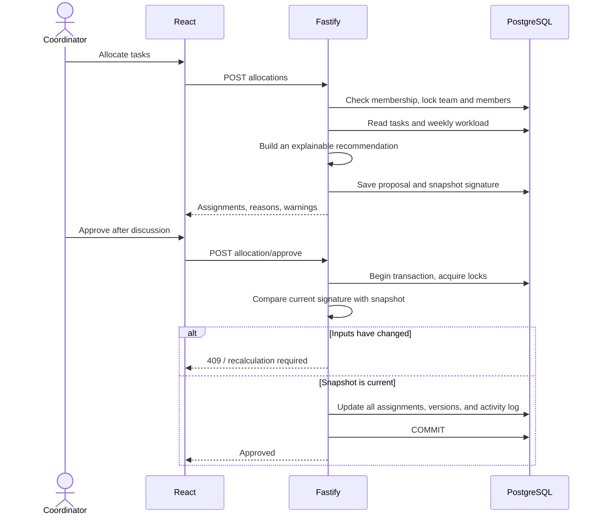

# FairShare architecture

Design date: October 2, 2026. Based on the completed M1 document, pages 2–4. This document describes the implemented MVP and identifies future work separately. VPS deployment was completed on October 3, 2026.

## 1. Product and constraints

FairShare helps students turn a course milestone into understandable tasks, agree on workload, and make obstacles visible early. The main workflow is **milestone → tasks with context → availability and skills → recommendation → discussion and approval → work → result**.

Observations in the product vision PDF come from the team's previous projects. Acceptance of the algorithm and the accuracy of hour estimates remain hypotheses. Neither hours nor activity counts are objective measures of contribution. Avoiding public inactivity rankings, automated grades, and accusations is a product decision, rather than a database limitation.

The initial working assumption is small student teams, several parallel projects, and a single weekly planning interval. Scale limits have not been validated through load testing.

## 2. Technology choices for this product

| Option | Strengths | Limitations | Decision |
| --- | --- | --- | --- |
| React + Vite + separate API | Suitable for boards, forms, and shared workspaces; clear client/server boundaries | Sessions and API behavior need explicit implementation | Selected |
| Next.js | SSR, public pages, server rendering, and the React ecosystem | SSR offers limited product value for a private board and adds another server mechanism | A good alternative if a public portal is introduced |
| Vue / Svelte | Suitable for the same product | Switching would not improve the core workflow; the user preferred React | Not needed for this version |
| Flutter / React Native | Native mobile workflows and push notifications | Installation and separate platform testing increase the cost of the first experiment | Consider after validating mobile demand |
| Electron / Tauri | Desktop application support | No requirement for local files, an IDE, or system APIs | Not required |
| Firebase / Firestore | Quick authentication and synchronization setup | Team relationships, tasks, dependencies, versions, and atomic assignment fit a relational model better | PostgreSQL is a better fit for the data |

React's official documentation recommends starting with a framework. This project deliberately uses a Vite SPA: the educational product has a separate API, a private workspace, no SEO requirement, and can validate its main workflow without SSR. This is a FairShare-specific decision, rather than a general claim about React.

### Implemented technologies

| Layer | Implementation | Rationale |
| --- | --- | --- |
| Client | React, TypeScript, Vite, CSS tokens, Inter, Lucide | Interactive board, reusable components, and readable types |
| HTTP API | Node.js, Fastify, Zod | Small server, boundary validation, and explicit feature modules |
| Domain | Pure TypeScript allocation function | Testable independently of HTTP and the database |
| Data | PostgreSQL: local PGlite and `pg` for an external database | Shared SQL and transactional workflows without requiring Docker locally |
| Identity | Email/password, scrypt, random server sessions | Working local authentication without external accounts or mandatory API keys |
| Synchronization | REST and 15-second polling | Simple initial consistency model; user changes trigger immediate refetching |
| Verification | node:test, Fastify inject, Playwright Chromium | Domain, API, and real interface checks |

Exact installed versions are recorded in `package-lock.json`. Any compatible provider may supply managed PostgreSQL. Supabase was investigated as a PostgreSQL/Auth option; the code does not use its SDK or require a Supabase project. If its database is chosen, the server connects through `pg`; the Data API must not expose these tables. Supabase Auth would be a future replacement for the Identity module, not an implemented feature.

## 3. Architectural style

A **modular monolith**: one server process, one relational database, and several functional modules. This suits a team of two or three developers. Distributed transactions, separate queues, and microservice contract coordination would add little value at this stage.

The implementation uses separation of concerns, typed boundaries, UI composition, an independent domain algorithm, a shared `Sql/Database` port, transactional workflows, optimistic locking for tasks, and explicit authorization. Calling this a strict Clean Architecture implementation would be inaccurate: SQL and application workflows sit alongside HTTP handlers inside feature modules. As the system grows, they can move into `application/` and `repositories/` while preserving the HTTP contract and domain function.

### System context

External documents remain with their owners; FairShare stores only a link and title. The application does not download code or assess its quality.

### Containers and data

These are C4-style Mermaid diagrams, rather than formal UML. A static SVG container diagram supports reading outside Markdown. The surrounding text provides an accessible alternative. Wide SVGs should scroll instead of shrinking until their labels become unreadable.

## 4. Modules and ownership

| Module | Responsibility | Main files |
| --- | --- | --- |
| Identity | Accounts, passwords, sessions, demo login | `server/auth.ts`, `server/security.ts` |
| Workspace | Project access, member lists, aggregated workload | `server/workspace.ts` |
| Projects | Teams, projects, milestones, invitations, availability | `server/projects.ts` |
| Tasks | Task context, statuses, dependencies, help, results | `server/tasks.ts` |
| Allocation | Proposals and transactional approval | `server/allocation.ts`, `server/allocations.ts` |
| Collaboration | Discussions, steps, resources, decisions, votes | `server/collaboration.ts` |
| Persistence | Shared SQL port, adapters, schema, educational seed | `server/db.ts`, `server/schema.sql`, `server/seed.ts` |
| Web | Navigation, workspace views, dialogs | `src/components`, `src/features` |
| Contracts | Shared client/server types and OpenAPI | `shared/types.ts`, `contracts/openapi.yaml` |

In a larger version, application workflows should depend on repository ports rather than importing Fastify. The allocation domain already respects this boundary: it knows nothing about cookies, HTTP, PostgreSQL, or React.

## 5. Allocation approval workflow

Membership, availability, and existing assignments are shared across projects. Team and user records are locked before changes; user locks follow a stable UUID order to reduce deadlock risk. Availability updates lock the user's record. Approval rereads the snapshot under those locks. Protection is enforced by the server regardless of the client button's state.

The snapshot includes milestone revision, task IDs and versions, team membership, skills, available hours, and workload. A change to another project's task in the same week changes workload, invalidating an earlier proposal. Approving an already approved proposal returns success without assigning tasks again: the operation is idempotent.

## 6. Client architecture

`App` coordinates sessions and project/milestone selection; `AppShell` handles navigation. The board, workload, team, personal tasks, and activity log are separate feature components. Shared `Modal`, `Button`, `Avatar`, and `Progress` components provide consistent behavior.

The API client uses same-origin cookies. Saved data is reread from the server, avoiding disagreement between an optimistic interface and server authorization. A request counter protects the main workspace against stale responses when switching projects. A larger version should use TanStack Query with keys such as `[projectId, milestoneId]`, request cancellation, deduplication, and centralized invalidation.

Drag-and-drop is not required: task status changes through an accessible form. Keyboard controls, dialog focus handling, Escape dismissal, mobile layout, text contrast, and reduced motion are supported. These are implemented measures; a separate audit is required before claiming full WCAG certification.

## 7. Hosting and growth

Locally, one Node process serves the React build and API; PGlite stores data on disk. Do not open a PGlite directory from several processes or place it on ephemeral hosting storage.

The deployed VPS runs the static build and Node API behind Nginx HTTPS, with separate PostgreSQL, a dedicated application account, systemd startup/recovery, daily backups, and a tested release rollback. See [VPS operations](../deploy/README.md).

For a pilot, maintain separate demo/staging/production environments and manage environment secrets. Keeping React and the API on one origin reduces cookie and CORS complexity. Hosting providers remain independent of the product domain.

Horizontal scaling first requires regular PostgreSQL, shared rate limiting, and consistent session rules. Push synchronization can use SSE/WebSocket with membership checks and a durable event cursor. If email or notifications are added, save the event and an outbox entry in one transaction; a worker delivers them with retries. Redis becomes useful when queue or presence demand is established. Kubernetes is not a launch requirement.

## 8. Non-functional targets and current boundaries

Pilot targets, not validated load measurements: ordinary API p95 below 500 ms with 50 active users; allocation of 100 tasks across 10 members within one second; synchronization of other users' changes within 15 seconds plus network latency; production database recovery within four hours, with up to 24 hours of data loss under daily backups.

Implemented capabilities include transactional approval, version checks, membership authorization, sessions, activity history, VPS hosting, and tested database backup restoration. Password recovery, email verification, file storage, email/push delivery, comprehensive versioned migrations for an existing production database, individual member approval of assignments, and multi-instance infrastructure remain future work. They are described in the roadmap.
