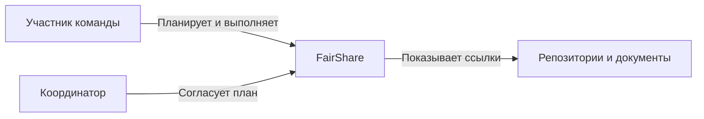
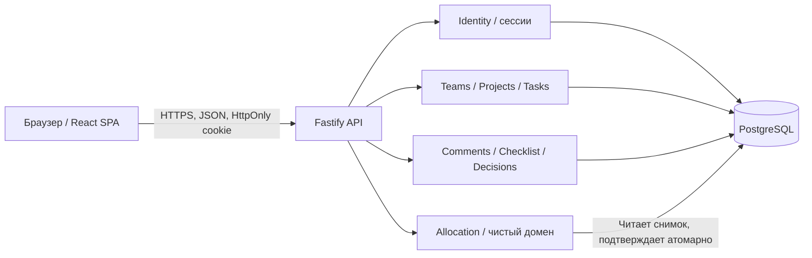
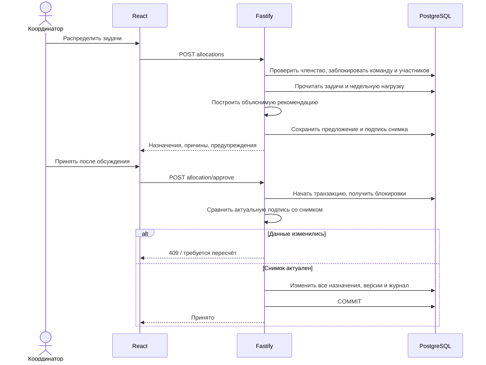

# Архитектура FairShare

Проектирование: 2 октября 2026 года. Основание — заполненный M1, страницы 2–4. Документ описывает реализованный MVP и обозначает дальнейшее развитие отдельно.

## 1. Продукт и ограничения

FairShare помогает студентам распределить учебный этап на понятные задачи, согласовать нагрузку и своевременно показать препятствия. Основная пользовательская цепочка: **этап → задачи с контекстом → доступность и навыки → рекомендация → обсуждение и подтверждение → работа → результат**.

В PDF наблюдения основаны на прошлых проектах самой команды, а принятие алгоритма и точность оценки часов остаются гипотезами. Нельзя считать часы или число действий объективным вкладом. Отказ от публичных рейтингов «пассивности», автоматических оценок и обвинений — продуктовый выбор, а не ограничение базы.

Рабочее допущение для первой версии: небольшие студенческие команды, несколько параллельных проектов, один недельный интервал планирования. Ограничения масштаба ещё не подтверждены нагрузочным исследованием.

## 2. Какой стек лучше именно здесь

| Вариант | Сильные стороны | Ограничения | Решение |
| --- | --- | --- | --- |
| React + Vite + отдельный API | Удобен для досок, форм и совместного рабочего пространства; понятные границы клиента и сервера | Нужно самостоятельно организовать сессии и API | Выбран |
| Next.js | SSR, публичные страницы, серверный рендеринг, экосистема React | Для закрытой доски SSR не даёт существенной продуктовой выгоды; добавляет второй серверный механизм | Хорошая альтернатива при появлении публичного портала |
| Vue / Svelte | Подходят для того же продукта | Переход не улучшает основной сценарий, а пользователь предпочёл React | Не нужны для этой версии |
| Flutter / React Native | Нативные мобильные сценарии, push | Установка приложения и отдельное тестирование платформ увеличивают стоимость первого эксперимента | После подтверждения мобильной потребности |
| Electron / Tauri | Настольное приложение | Нет потребности в локальных файлах, IDE или системном API | Не требуется |
| Firebase / Firestore | Быстрый старт Auth и синхронизации | Связи команды, задачи, зависимости, версии и атомарные назначения удобнее моделировать реляционно | PostgreSQL лучше соответствует данным |

Официальная документация React рекомендует начинать с фреймворка. Здесь осознанно выбран SPA на Vite: учебный продукт имеет отдельный API, закрытую рабочую область, не требует SEO и позволяет проверить основной сценарий без SSR. Это решение для FairShare, не универсальное утверждение о React.

### Конкретные технологии

| Слой | Реализовано | Причина |
| --- | --- | --- |
| Клиент | React, TypeScript, Vite, CSS tokens, Inter, Lucide | Интерактивная доска, повторно используемые компоненты, читаемые типы |
| HTTP API | Node.js, Fastify, Zod | Небольшой сервер; валидация на границе; явные feature-модули |
| Домен | Чистая TypeScript-функция распределения | Можно проверять отдельно от HTTP и базы |
| Данные | PostgreSQL: PGlite локально, адаптер `pg` для внешней БД | Один язык SQL и транзакционные сценарии, без установки Docker для локального MVP |
| Идентификация | Email/пароль, scrypt, случайные серверные сессии | Рабочий локальный вход без внешнего аккаунта и обязательных ключей |
| Синхронизация | REST + опрос каждые 15 секунд | Простая согласованная первая версия; пользовательские изменения сразу перечитываются |
| Проверка | node:test, Fastify inject, Playwright Chromium | Проверки домена, API и реального интерфейса |

Точные установленные версии зафиксированы `package-lock.json`. Управляемая PostgreSQL допустима у любого совместимого провайдера. Supabase изучен как вариант PostgreSQL/Auth; текущий код не использует Supabase SDK и не требует Supabase-проекта. Если выбрать его базу, приложение подключается серверным адаптером `pg`; Data API для этих таблиц должен быть закрыт. Подключение Supabase Auth — отдельная будущая замена модуля Identity, а не реализованная функция.

## 3. Архитектурный стиль

**Модульный монолит**: один серверный процесс, одна реляционная база, несколько функциональных модулей. Он подходит команде из 2–3 разработчиков: распределённые транзакции, отдельные очереди и согласование контрактов микросервисов пока не дают полезного результата.

Использованы принцип разделения ответственности, типизированные границы, композиция UI, независимый доменный алгоритм, общий порт базы `Sql/Database`, транзакционные сценарии, optimistic locking для задач и явная проверка полномочий. Называть MVP строгой реализацией Clean Architecture было бы неточно: SQL и сервисные сценарии находятся рядом с HTTP-обработчиками внутри feature-модулей. При росте их можно вынести в `application/` и `repositories/`, сохранив HTTP-контракт и доменную функцию.

### Контекст системы

Внешние документы хранятся у владельцев; FairShare сохраняет только ссылку и название. Приложение не загружает код и не анализирует его качество.

### Контейнеры и данные

Это C4-подобные схемы в Mermaid, а не формальный UML. Статическая SVG-версия контейнеров предназначена для чтения вне Markdown. Текст вокруг схемы — её доступная альтернатива. Широкие SVG следует прокручивать, а не уменьшать до нечитаемого размера.

## 4. Модули и владение

| Модуль | Ответственность | Основные файлы |
| --- | --- | --- |
| Identity | Аккаунты, пароль, сессии, демовход | `server/auth.ts`, `server/security.ts` |
| Workspace | Доступ к проекту, список участников, агрегированная нагрузка | `server/workspace.ts` |
| Projects | Команды, проекты, этапы, приглашения, доступность | `server/projects.ts` |
| Tasks | Контекст задачи, статусы, зависимости, помощь, результат | `server/tasks.ts` |
| Allocation | Предложение и транзакционное принятие | `server/allocation.ts`, `server/allocations.ts` |
| Collaboration | Обсуждения, шаги, материалы, решения и голоса | `server/collaboration.ts` |
| Persistence | Общий SQL-порт, адаптеры, схема, учебный seed | `server/db.ts`, `server/schema.sql`, `server/seed.ts` |
| Web | Навигация, рабочие представления, диалоги | `src/components`, `src/features` |
| Contracts | Типы клиента/сервера и OpenAPI | `shared/types.ts`, `contracts/openapi.yaml` |

В новой большой версии сервисный сценарий должен зависеть от порта репозитория, а не импортировать Fastify. Домен распределения уже соблюдает эту границу: не знает о cookies, HTTP, PostgreSQL и React.

## 5. Сценарий подтверждения распределения

Членство, доступность и уже назначенная работа — общий контекст нескольких проектов. Записи команды и пользователей блокируются до изменения; пользователи — в стабильном порядке UUID, чтобы уменьшить риск взаимных блокировок. Доступность пользователя блокирует его запись. Подтверждение повторно читает снимок под блокировками. Защита работает на сервере, независимо от состояния кнопки клиента.

Снимок включает версию этапа, IDs и версии задач, состав команды, навыки, часы доступности и нагрузку. Изменение задачи в другом проекте за ту же неделю изменит нагрузку, поэтому старое предложение также отклоняется. Повторное принятие уже принятого предложения возвращает успех без повторного назначения: идемпотентность.

## 6. Клиентская архитектура

`App` координирует сессию, выбор проекта и этапа; `AppShell` отвечает за навигацию. Доска, нагрузка, команда, личные задачи и журнал — отдельные feature-компоненты. Общие `Modal`, `Button`, `Avatar`, `Progress` задают единое поведение.

API-клиент использует same-origin cookies. При сохранении данные перечитываются с сервера, что исключает расхождение оптимистичного интерфейса с проверкой прав. Номер запроса защищает основное пространство от устаревшего ответа при переключении проектов. В будущей версии с большим числом экранов нужен TanStack Query: ключи вида `[projectId, milestoneId]`, отмена запросов, дедупликация и централизованная инвалидизация.

Перетаскивание не требуется для управления задачей: статус меняется в доступной форме. Клавиатура, фокус в диалогах, Escape, мобильная компоновка, контраст текста и reduced motion поддерживаются. Это набор реализованных мер; полную сертификацию WCAG без отдельного аудита заявлять нельзя.

## 7. Размещение и развитие

Локально один Node-процесс раздаёт сборку React и API; PGlite хранит данные на диске. PGlite не следует подключать одновременно к нескольким процессам или держать на временном диске hosting-платформы.

Для пилота: статическая сборка + Node API за HTTPS, управляемая PostgreSQL, секреты окружения, отдельные окружения demo/staging/production. Можно оставить React и API на одном домене: меньше сложностей с cookies и CORS. Провайдер размещения не связан с доменом продукта.

При горизонтальном масштабировании сначала используются обычная PostgreSQL, распределённый rate limit и общие правила сессий. Для push-синхронизации — SSE/WebSocket с проверкой членства и устойчивым курсором событий. Если появятся письма/уведомления, событие и запись outbox сохраняются одной транзакцией, worker доставляет их с повторными попытками. Redis нужен при подтверждённой нагрузке очередей или presence; Kubernetes не является условием запуска.

## 8. Нефункциональные цели и честные границы

Цели пилота, ещё не подтверждённые нагрузочным измерением: p95 обычного API до 500 мс при 50 активных пользователях; распределение 100 задач между 10 участниками до 1 секунды; синхронизация чужих изменений до 15 секунд плюс сетевое время; восстановление production-базы за 4 часа, допустимая потеря до 24 часов при ежедневной резервной копии.

Реализованы транзакционное принятие, контроль версий, проверки членства, сессии и история. Не реализованы восстановление пароля, проверка email, файловое хранилище, email/push, полноценные versioned migrations для уже существующей production-базы, индивидуальное принятие назначения каждым участником и multi-instance инфраструктура. Эти работы описаны в дорожной карте, а не скрыты за макетом.
