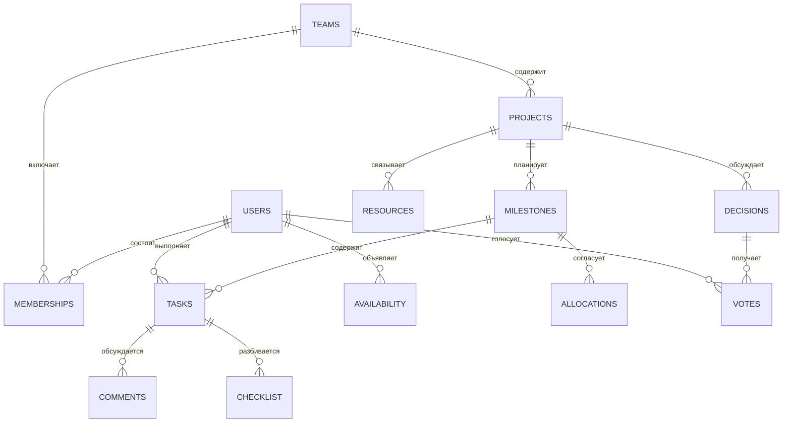

# Данные, права и эксплуатация

## Сущности

| Таблица | Назначение | Ограничения |
| --- | --- | --- |
| users | Аккаунты, навыки | Уникальный email, scrypt-хэш |
| sessions | Серверные сессии | Только хэш токена, срок, FK пользователя |
| teams / memberships | Команды и роли | PK team/user, один координатор на команду |
| availability | Часы на неделю | PK user/week, 0–100 часов |
| projects / milestones | Проекты и недельные этапы | FK команды и проекта, revision этапа |
| tasks | Контекст и ход работы | Составные FK этап/проект и зависимость/проект, часы > 0, version |
| allocations | Предложения распределения | Снимок, автор, payload, состояние принятия |
| invitations | Одноразовые приглашения | Хэш токена, срок, used_by |
| events | История действий | Проект, пользователь, тип, минимум контекста |
| comments / checklist | Обсуждения и конкретные шаги | FK задачи, удаление вместе с ней |
| resources | Внешние материалы | Название, HTTP/HTTPS URL, автор |
| decisions / votes | Договорённости | Один голос на user/decision, явное закрытие |

Исполняемая схема: `server/schema.sql`. API дополнительно проверяет календарные даты, начало недели в понедельник, срок внутри недели, шаг оценки 0,25 часа, цикл зависимости, членство исполнителя и условия статуса. Прямое администраторское изменение БД обходит правила, не продублированные в SQL.

## Состояния задачи

`planned → in_progress → done`. Можно вернуть задачу в план или сразу завершить её, если есть исполнитель, завершена зависимость и описан результат. Для завершения нужен текст/ссылка от 10 символов и снятый запрос помощи. Повторное открытие завершённой задачи требует проверки доступности. Help — отдельное поле, которое не скрывает основной статус.

`started_at` означает заявленное начало, `first_evidence_at` — первое описание/ссылку, `done_at` — завершение. Это технические события, которые не доказывают содержательность работы автоматически.

## Права

| Действие | Координатор | Участник |
| --- | --- | --- |
| Читать свою команду | Да | Да |
| Читать чужую команду | Нет | Нет |
| Создать задачу | Да | Да |
| Менять условия и назначение | Да | Нет |
| Менять статус, помощь, результат | Любая задача команды | Только собственная назначенная |
| Удалять актуальную planned-задачу без зависимых | Да | Нет |
| Менять собственные навыки/часы | Да | Да |
| Менять чужие часы | Нет | Нет |
| Создавать проект, этап, приглашение | Да | Нет |
| Предложить и принять распределение | Да | Нет |
| Обсуждать, добавлять шаги и материалы | Да | Да |
| Предлагать решение, голосовать | Да | Да |
| Фиксировать итог решения | Да | Нет |

Сервер проверяет членство на каждом запросе. UUID не даёт доступ. Объект вне своей команды возвращает 404; запрещённое действие — 403. Отдельного суперпользователя в пользовательском API нет.

## Реализованная защита

- Пароли: индивидуальная соль и scrypt. В БД и логах нет открытых паролей.
- Сессия: 32 случайных байта, в БД SHA-256-хэш, срок 7 дней. Cookie HttpOnly/SameSite=Strict, в production Secure. Выход удаляет серверную сессию.
- Проверка Origin и Sec-Fetch-Site на изменяющих запросах; в production точный APP_ORIGIN. Произвольный CORS не включён.
- Zod, параметризованный SQL, тело до 100 KB. Вход/регистрация ограничены 12 запросами в минуту на IP текущего процесса.
- React экранирует текст. Общие ссылки принимают HTTP/HTTPS, открываются с noopener/noreferrer.
- API: no-store. Статические ответы: CSP, nosniff, no-referrer, DENY iframe.
- Приглашения одноразовые, 24 часа, хранятся хэши. Отправка остаётся действием пользователя.
- Задачи имеют version; принятие распределения атомарно и проверяет подпись снимка. Блокируются команда и участники в стабильном порядке.
- NODE_ENV=production отключает демовход по умолчанию. Отключение маршрута не удаляет учебные аккаунты: внешнему пилоту нужна отдельная чистая база.

## Перед внешним пилотом

Проверка email, восстановление пароля, политика хранения/удаления, резервные копии с проверенным восстановлением, наблюдения ошибок, versioned migrations и разные учётные данные runtime/migration пока не реализованы. В текущем MVP схема идемпотентно создаёт таблицы; это не полноценный механизм эволюции production-базы.

Если выбрать Supabase-провайдер: закрыть Data API для серверных таблиц и grants клиентских ролей или использовать неэкспонируемую схему. Любые экспонируемые таблицы требуют RLS; service/secret key нельзя помещать в React. В текущем приложении данные защищаются API-проверками, клиент не имеет доступа к БД. Supabase Auth не подключён.

Несколько API-процессов требуют обычной PostgreSQL, общего rate limit и проверки конкурентных блокировок. PGlite предназначена для одного процесса; нельзя одновременно открывать один её каталог двумя серверами или хранить его на временном диске hosting-платформы.

## Хранение и эксплуатация

В MVP нет удаления аккаунта/проекта, архива и удаления обсуждения. Просроченные сессии проверяются на каждом запросе и очищаются при старте. Добавление управления сроками хранения входит в дорожную карту.

`/api/health` проверяет БД. CI: npm ci → typecheck → test → build. Локальную PGlite резервировать после корректного завершения процесса; перенос в обычную PostgreSQL требует экспорта/импорта. Production использует резервные копии PostgreSQL-провайдера и регулярную проверку восстановления в отдельное окружение. Предлагаемые RPO 24 часа и RTO 4 часа — цели пилота, не измеренный SLA.
