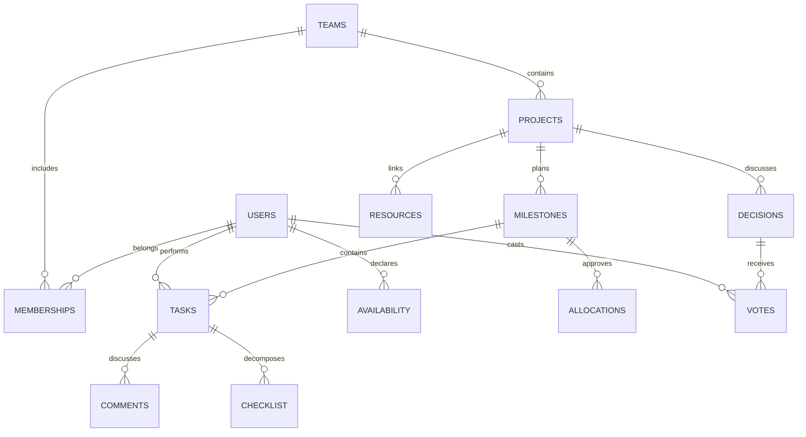

# Data, permissions, and operations

## Entities

| Table | Purpose | Constraints |
| --- | --- | --- |
| users | Accounts and skills | Unique email, scrypt password hash |
| sessions | Server-side sessions | Token hash only, expiry, user FK |
| teams / memberships | Teams and roles | Team/user primary key, one coordinator per team |
| availability | Weekly hours | User/week primary key, 0–100 hours |
| projects / milestones | Projects and weekly milestones | Team and project FKs, milestone revision |
| tasks | Context and work progress | Composite milestone/project and dependency/project FKs, positive hours, version |
| allocations | Allocation proposals | Snapshot, creator, payload, approval state |
| invitations | Single-use invitations | Token hash, expiry, `used_by` |
| events | Activity history | Project, user, type, minimal context |
| comments / checklist | Discussions and concrete steps | Task FK, cascade deletion with the task |
| resources | External resources | Title, HTTP/HTTPS URL, author |
| decisions / votes | Team agreements | One vote per user/decision, explicit closure |

Executable schema: `server/schema.sql`. The API additionally checks calendar dates, Monday week starts, due dates within the selected week, 0.25-hour estimate increments, dependency cycles, assignee membership, and status conditions. Direct administrative database edits bypass rules that are not duplicated in SQL.

## Task states

`planned → in_progress → done`. A task can return to planning or be completed directly if it has an assignee, its dependency is complete, and a result is described. Completion requires at least 10 characters of evidence text/link and no outstanding help request. Reopening a completed task requires availability checks. Help is a separate field and does not obscure the main status.

`started_at` records the declared start, `first_evidence_at` the first result description/link, and `done_at` completion. These are technical events; they do not automatically prove meaningful work.

## Permissions

| Action | Coordinator | Member |
| --- | --- | --- |
| Read own team | Yes | Yes |
| Read another team | No | No |
| Create a task | Yes | Yes |
| Change task requirements and assignment | Yes | No |
| Change status, help, or result | Any task in the team | Own assigned tasks only |
| Delete a current planned task with no dependents | Yes | No |
| Change own skills/hours | Yes | Yes |
| Change another user's hours | No | No |
| Create a project, milestone, or invitation | Yes | No |
| Propose and approve allocation | Yes | No |
| Discuss and add steps/resources | Yes | Yes |
| Propose a decision or vote | Yes | Yes |
| Record a decision outcome | Yes | No |

The server checks membership on every request. Knowing a UUID does not grant access. An object outside the user's team returns 404; a prohibited action returns 403. There is no superuser role in the user-facing API.

## Implemented protections

- Passwords use individual salts and scrypt. Plaintext passwords are not stored in the database or logs.
- New passwords require 15–128 characters, permit spaces and Unicode, and have no mandatory character categories. Passwords are not trimmed. Existing shorter passwords remain valid on login. Email addresses are trimmed and lowercased; authentication validation is shared between client and server.
- Authenticated users can change their own password with the current password and matching confirmation. The server rejects reuse of the current password, revokes all existing sessions, and creates a fresh current-browser session atomically. User-row locking serializes password changes with session creation; the session is rechecked inside the change transaction. Shared demo passwords cannot be changed while demo mode is enabled. This is distinct from forgotten-password recovery, which still requires email delivery.
- Sessions use 32 random bytes, stored as SHA-256 hashes, and expire after seven days. Cookies are HttpOnly/SameSite=Strict, with Secure enabled in production. Successful authentication rotates the current browser session and revokes its previous token in the same transaction; failed login preserves the current session. Logout deletes the server session.
- Mutating requests check Origin and Sec-Fetch-Site; production requires the exact `APP_ORIGIN`. Arbitrary CORS is not enabled.
- Zod validation, parameterized SQL, and a 100 KB body limit. Login, registration, password changes, and enabled demo login share a limit of 12 requests per minute per IP within the current process, with an error message and Retry-After header. Unknown emails perform dummy scrypt verification; unknown-account and incorrect-password login failures return the same error.
- Only the loopback reverse proxy is trusted to supply client IPs. The deployed application listens on localhost behind Nginx.
- React escapes text. Shared links accept HTTP/HTTPS and open with noopener/noreferrer.
- API responses use no-store. Static responses include CSP, nosniff, no-referrer, and iframe DENY protections.
- Invitations are single-use, valid for 24 hours, and stored as hashes. Sharing an invitation remains the user's action.
- Registration can consume an invitation in the account-creation transaction. It grants member access to the invited team without creating an unrelated team. An invalid, expired, or used invitation rolls back account creation; normal login still accepts a pending invitation after authentication.
- Tasks carry versions; allocation approval is atomic and validates the snapshot signature. Team and member records are locked in a stable order.
- `NODE_ENV=production` disables demo login by default. Removing the route does not delete educational accounts: an external pilot needs a separate clean database.

## Before a broader external pilot

Email verification, password recovery, retention/deletion policies, comprehensive error monitoring, versioned migrations, and separate runtime/migration credentials remain future work. The current schema creates tables idempotently; it is not a complete production schema evolution mechanism.

VPS backups and restoration were implemented and verified on October 3, 2026. Daily backups include the PostgreSQL dump, source, configuration, and checksums. A full restore was tested in a separate database. See the [VPS guide](../deploy/README.md) for retention and download procedures.

If Supabase is selected as the database provider, disable its Data API for server-owned tables and client-role grants, or use a non-exposed schema. Exposed tables require RLS. Service/secret keys must never be included in React. This application protects data through API checks; the client does not access the database directly. Supabase Auth is not integrated.

Multiple API processes require regular PostgreSQL, shared rate limiting, and concurrency lock verification. PGlite is intended for a single process; do not open the same directory from two servers or store it on ephemeral hosting storage.

## Retention and operations

The MVP does not provide account/project deletion, archiving, or discussion deletion. Session expiry is checked on each request, and expired sessions are removed at startup. Retention controls are part of the roadmap.

`/api/health` checks database connectivity. The recommended verification pipeline is `npm ci → typecheck → test → build`; it is not an installed GitHub Actions workflow. Back up local PGlite after a clean process shutdown; moving to regular PostgreSQL requires export/import.

The deployed VPS uses local PostgreSQL and a daily systemd backup timer. Broader hosting can use provider backups plus regular restore tests in a separate environment. Proposed RPO of 24 hours and RTO of four hours are pilot targets, not a measured SLA. VPS measures include key-only SSH, disabled root login, a firewall, fail2ban, automatic security updates without automatic reboots, swap, and log storage limits.
